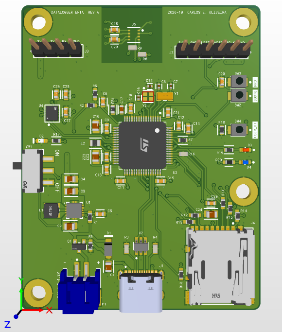
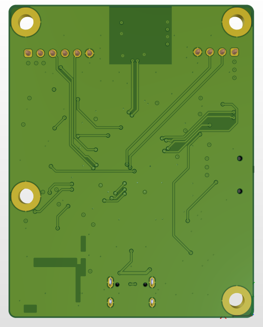

# Datalogger Ambiental e Inercial — STM32U5A5

Datalogger para o payload de um foguete: registra **temperatura, umidade e pressão** (BME280, I2C) e **aceleração e velocidade angular** (LSM6DSOX, SPI) durante todo o voo, gravando os dados em **CSV num cartão microSD** (SDMMC 4 bits + FatFs).

Projeto desenvolvido para o **Desafio do Processo Seletivo da Payload — EPTA (Equipe de Propulsão e Tecnologia Aeroespacial, UFU)**. O enunciado está em [`docs/Desafio_Payload_Datalogger_STM32.pdf`](docs/Desafio_Payload_Datalogger_STM32.pdf).

> 🚧 **Em desenvolvimento.** Entrega prevista para 24/10/2026.

---

## Visão geral

| Bloco | Componente | Interface |
|---|---|---|
| MCU | STM32U5A5 (Cortex-M33, 160 MHz) | — |
| Temperatura, umidade e pressão | BME280 | I2C |
| IMU (acelerômetro + giroscópio) | LSM6DSOX | SPI + INT1 (data-ready) |
| Armazenamento | Slot microSD | SDMMC 4 bits + FatFs |
| Energia | Bateria LiPo 1S + USB-C, seleção automática, buck-boost 3,3 V (TPS63001) | — |
| Depuração | Conector SWD (6 pinos) + UART de debug (4 pinos) | SWDIO / SWCLK / SWO, USART1 |

- **Protótipo:** placa NUCLEO-U5A5ZJ-Q com os sensores em protoboard.
- **PCB:** projeto próprio no Altium Designer, 4 camadas, com o STM32U5A5RJT6Q (LQFP64). É a mesma família da Nucleo e usa os mesmos pinos, então o firmware é o mesmo nos dois.

## Estrutura do repositório

```
├── fw-datalogger/datalogger/   Projeto STM32CubeIDE (STM32Cube FW_U5 V1.8.0)
├── hw-datalogger/datalogger/   Projeto Altium Designer: esquemático, PCB e OutJob
├── hw-datalogger/fabricacao/   Saídas de fabricação: Gerbers/furação (JLCPCB), BOM, posicionamento, STEP, PDF
├── docs/                         Enunciado, referências, diagramas e fotos
├── docs/testes/                  CSVs reais do cartão e logs da UART (ver docs/testes/README.md)
├── scripts/                      Análise dos CSVs em Python
└── README.md
```

## Pinagem

Os mesmos pinos são usados na Nucleo (STM32U5A5ZJT6Q, LQFP144) e na PCB (STM32U5A5RJT6Q, LQFP64).

| Função | Pinos | Observação na Nucleo |
|---|---|---|
| SDMMC1 (microSD) | PC8 D0, PC9 D1, PC10 D2, PC11 D3, PC12 CK, PD2 CMD | conector CN8 |
| Card detect | PA8 | |
| SPI1 → LSM6DSOX | PA5 SCK, PA6 MISO, PA7 MOSI, PA4 CS | CN7 D13/D12/D11 |
| LSM6DSOX INT1 / INT2 | PB1 / PB2 | (PB0 não existe no LQFP64 com SMPS) |
| I2C3 → BME280 | PC0 SCL, PC1 SDA | CN9 A5/A4 |
| USB | PA11 DM, PA12 DP | USB-C da Nucleo (CN15) |
| SWD | PA13 SWDIO, PA14 SWCLK, PB3 SWO | ST-LINK |
| UART de debug | USART1: PA9 TX, PA10 RX | Virtual COM do ST-LINK |
| Cristais | PH0/PH1 HSE 16 MHz, PC14/PC15 LSE 32,768 kHz | |
| LED status / erro | PC7 / PB7 | LD1 verde / LD2 azul (na PCB: azul / vermelho) |
| Botão | PC13 | B1 |
| Tensão da bateria | PA0 (ADC, com divisor) | |

### Protótipo na Nucleo

No protótipo, dois blocos usam ligações diferentes da PCB. As duas opções são selecionadas em `app/inc/hal_cfg.h`, sem mexer no resto do firmware.

| Bloco | Protótipo (Nucleo) | Seleção em `hal_cfg.h` |
|---|---|---|
| LSM6DSOX | módulo montado para I2C, no I2C1: PB8 SCL (CN7 D15), PB9 SDA (CN7 D14), endereço 0x6B detectado no init; INT1 em PB1 com pull-down | `HAL_IMU_BUS` = `HAL_IMU_BUS_I2C` (PCB: `HAL_IMU_BUS_SPI`) |
| microSD | módulo Adafruit microSD Card BFF em SDMMC 1 bit: PC12 CK, PD2 CMD, PC8 D0, CS/D3 em 3V3 | `HAL_SD_BUS_WIDTH` = 1 (PCB: 4), `HAL_SD_CD_ENABLED` = 0 |

## Hardware (PCB)

Projeto no Altium Designer em `hw-datalogger/datalogger/` (folhas hierárquicas `00_Top`, `01_Power`, `02_MCU`, `03_Sensors`, `04_microSD`, `05_Interface`). Esquemático completo em PDF: [`hw-datalogger/fabricacao/dataloggerOutJob.PDF`](hw-datalogger/fabricacao/dataloggerOutJob.PDF).

| Vista 3D — Top | Vista 3D — Bottom |
|---|---|
|  |  |

### Resumo da placa

| Item | Valor |
|---|---|
| Dimensões | 50,8 × 64,8 mm, cantos arredondados, 4 furos M3 (ligados ao GND) |
| Camadas | 4 — Top (sinal) / **GND** (plano) / **3V3** (plano) / Bottom (sinal) |
| Empilhamento | JLCPCB JLC04161H-2313, 1,6 mm, cobre 1 oz externo / 0,5 oz interno |
| Montagem | Todos os componentes no Top (montagem em um lado só) |
| Passivos | 0603 (capacitores dos cristais em 0402, C0G) |
| Regras (mil) | Trilha/folga 6/6 (sinal 10, alimentação ≥ 20), via 24/12 *tented*, anel ≥ 6, furo-furo ≥ 20, cobre-borda ≥ 12 |

### Decisões de projeto

- **Alimentação:** bateria LiPo 1S (JST-PH) ou USB-C, sem carregador na placa. Um MOSFET P (DMG2305UX) faz a função de diodo ideal para a bateria e o Schottky B5819W leva o VBUS, com prioridade para a USB quando ela está conectada. O conector USB-C tem 5,1 kΩ nos CC1/CC2 e proteção ESD (USBLC6-2SC6).
- **Regulação de 3,3 V com buck-boost (TPS63001):** a LiPo varia de 4,2 V a 3,0 V e passa abaixo de 3,3 V; um buck-boost mantém os 3,3 V em toda a descarga e também a partir dos 5 V da USB. A chave liga/desliga atua no EN do regulador.
- **Layout do regulador** segundo o exemplo do datasheet: indutor colado nos pinos L1/L2, nós de chaveamento com polígonos pequenos, capacitores de entrada e saída junto aos pinos, ligação direta (sem alívio térmico) e vias no PowerPAD.
- **SMPS interno do STM32U5:** indutor de 2,2 µH (LQM21PN2R2MGHL, o mesmo da Nucleo), 2 × 2,2 µF nos pinos VDD11 (ligados entre si) e 10 µF + 100 nF no VDDSMPS. Os laços VDDSMPS → VLX → indutor → VDD11 ficaram todos no Top, sem vias, com o 100 nF colado no pino.
- **Desacoplamento:** um 100 nF por pino de alimentação, com via de GND e de 3V3 no lado de fora do capacitor (pino → capacitor → via). VDDA filtrado por ferrite (BLM18PG221) com 1 µF + 100 nF.
- **Clock:** HSE de 16 MHz (ABM11W, CL 8 pF, 2 × 10 pF) e LSE de 32,768 kHz (ABS07, CL 7 pF, 2 × 8,2 pF), colados no MCU e sem trilhas passando por baixo.
- **Posicionamento:** o MCU foi girado para cada bloco ficar de frente para os seus pinos (cristais e I2C em cima, SPI/IMU à esquerda, USB e microSD embaixo/direita). Entrada de energia e regulador agrupados numa borda.
- **BME280 isolado do calor:** no lado oposto ao regulador, perto da borda, com recorte nos polígonos de cobre do Top e do Bottom em volta dele.
- **IMU (LSM6DSOX):** alinhada às bordas da placa, perto do MCU (SPI curto) e longe do regulador. A posição em relação ao centro da placa permite corrigir o braço de alavanca no pós-processamento.
- **USB:** D+/D− roteados como par diferencial (90 Ω nominais, Full Speed) do conector ao ESD e ao MCU, no Top e sobre o plano de GND. As duplicatas de D+/D− do USB-C são unidas junto ao conector (uma ponte curta no Bottom).
- **microSD (SDMMC 4 bits):** pull-ups de 47 kΩ em CMD e D0–D3, 33 Ω em série no CLK junto ao MCU, card detect em PA8, trilhas curtas sobre o GND.
- **GND:** planos internos contínuos (nenhuma trilha nas camadas internas), polígonos de GND no Top e no Bottom e costura de vias.

### Exceções de ERC e DRC (justificadas)

| Regra | Onde | Justificativa |
|---|---|---|
| ERC: *Nets with no driving source* → No Report | `ENB_REG`, `NRST` | São acionadas por componentes passivos (chave, botão e pull-up interno do MCU). |
| ERC: *Nets with multiple names* → No Report | rede 3V3 | Rótulos de desacoplamento por pino (`MCU_VDD_A/B/C…`) na mesma rede; *Power Port Names Take Priority* garante o nome 3V3 no PCB. |
| ERC: *I/O Pin × I/O Pin* → No Report | SPI, I2C, USB | Pinos bidirecionais por definição nos símbolos. |
| DRC: via 18/8 mil (anel 5 mil) | 2 vias de `USB_DM_NET` | Ponte do D− junto ao USB-C; dentro do mínimo da JLCPCB (0,2/0,45 mm). |
| DRC: *Minimum Solder Mask Sliver* = 0 | U1, U3, U4, U5, J1 | Componentes de passo 0,5 mm: abertura única de máscara na fileira de pads (padrão do fabricante). |
| DRC: folga pad-pad ignorada dentro do footprint | LSM6DSOX (LGA) | Pads do próprio fabricante com 0,15 mm de folga. |
| DRC: *Testpoint Usage* desligado | toda a placa | Sem teste elétrico automatizado. |

Resultado final: **ERC sem erros e DRC com 0 violações.**

### Fabricação (JLCPCB)

Os arquivos ficam em [`hw-datalogger/fabricacao/`](hw-datalogger/fabricacao/), gerados pelo `dataloggerOutJob.OutJob`:

- `JLCPCB/` e `JLCPCB.zip`: Gerbers (GTL, GP1, GP2, GBL, máscaras, serigrafias, pastas, contorno GM1) e furação NC Drill (PTH/NPTH e fendas).
- `BOM/`: lista de materiais com MPN (também em [`docs/datalogger.xlsx`](docs/datalogger.xlsx)).
- `Pick Place/`: posicionamento dos componentes.
- `ExportSTEP/`: modelo 3D da placa montada.

| Opção do pedido | Valor |
|---|---|
| Layers | 4 |
| Espessura | 1,6 mm |
| Stackup | JLC04161H-2313 — L1 GTL, L2 GP1 (GND), L3 GP2 (3V3), L4 GBL |
| Cobre externo / interno | 1 oz / 0,5 oz |
| Via covering | Tented |
| Acabamento | ENIG (recomendado pelos pads de passo fino) ou HASL sem chumbo |

## Firmware

Projeto do STM32CubeIDE em `fw-datalogger/datalogger/`. Fica organizado em camadas, e a aplicação não depende do MCU.

| Pasta | Papel |
|---|---|
| `Core/`, `Drivers/` | código gerado pelo CubeMX (HAL da ST). Só `main.c` foi tocado, nos blocos `USER CODE`: `hal_init()` e `hal_loop()` |
| `app/` | máquina de estados (`app.c`), gravação do CSV (`logger.c`) e configuração da placa (`app/inc/hal_cfg.h`) |
| `hal/` | interfaces genéricas (`hal_imu`, `hal_env`, `hal_sd`, `hal_gpio`, `hal_time`, `hal_led`, `hal_ser`, `hal_cpu`), cada uma uma `struct` de ponteiros de função |
| `port/stm32u5a5/` | implementação das interfaces sobre a HAL da ST, e os drivers dos chips em `imu/lsm6dsox.c` e `env/bme280.c`. Os drivers recebem o barramento (SPI ou I2C) por injeção |
| `utl/` | sem hardware: printf, buffer circular, debug por módulo e FatFs (`utl/fatfs/`, com `diskio.c` sobre `hal_sd`) |

Bibliotecas de terceiros: HAL/CMSIS da ST (STM32CubeU5), FatFs R0.16 e printf (MIT). Os drivers dos sensores foram escritos a partir dos datasheets. Detalhes e licenças em [`docs/referencias.md`](docs/referencias.md).

### Temporização

O firmware não usa nenhum TIM. Isso é proposital: cada função de tempo já tem uma fonte de hardware melhor.

| Função | Fonte | Por quê |
|---|---|---|
| Amostragem da IMU (416 Hz) | oscilador interno do LSM6DSOX, avisado pelo data-ready no INT1 (EXTI, sem polling) | A amostra é lida quando fica pronta. Um TIM para disparar a leitura correria em paralelo ao relógio da IMU, e o descompasso entre os dois faria amostras serem lidas repetidas ou puladas. |
| Medição do BME280 (~15 ms por amostra) | modo normal do sensor (medição contínua com tempo de standby) | O sensor mede sozinho; o loop só lê o resultado mais recente a cada 20 ms. |
| Timestamp do CSV (`t_ms`, resolução de 1 µs) | SysTick de 1 ms da HAL + contagem atual do SysTick (`SysTick->VAL`) | Dá µs sem gastar um timer. O SysTick tem a maior prioridade (0), acima do INT1 (5) e do botão (6), então o timestamp tirado na ISR é coerente. |
| Tarefas periódicas (LEDs, `f_sync` a cada 1 s, novas tentativas de recuperação, debounce do botão) | `HAL_IncTick()` sobrescrita (callbacks de 100 ms e 1 s) e comparação de tempo no loop | Nenhuma tem requisito de tempo rígido. |

O RTC (LSE de 32,768 kHz) está habilitado no `.ioc`, mas não é usado: o `t_ms` conta a partir do boot, e os arquivos levam data fixa no FAT (`FF_FS_NORTC`). Timestamps absolutos pelo RTC ficam como melhoria futura.

## Operação

1. Ao ligar, o firmware inicia a IMU, o BME280 e o cartão. Se tudo estiver OK, o LED de status fica **aceso** e o terminal mostra `Pronto: aperte o botao para gravar`.
2. **Botão B1:** começa a gravar num arquivo novo (`LOG_0001.CSV`, `LOG_0002.CSV`, …). O LED de status passa a **piscar 1x a cada 2 s**.
3. **Botão B1 de novo:** grava o que estiver no buffer, fecha o arquivo e volta ao LED aceso. Nesse estado o cartão pode ser removido com segurança.

| LED de erro | Significado |
|---|---|
| 2 pulsos | cartão ausente |
| 3 pulsos | falha de sensor no boot, ou BME280/IMU perdido durante a operação. Com sensor perdido a gravação continua e há tentativa de recuperação a cada 1 s (ver Problemas conhecidos) |
| piscando rápido | falha ao iniciar o cartão, ou cartão sem FAT (formatar em FAT32). Nova tentativa a cada 2 s; se estava gravando, continua num arquivo novo |
| aceso | cartão cheio: a gravação é encerrada |

A UART de debug (USART1, Virtual COM do ST-LINK, 115200 8N1) imprime uma linha por segundo com o BME280, a IMU (amostras/s, erros, resgates do INT1) e o arquivo (linhas, amostras perdidas, ocupação do buffer). A cada 5 s imprime também o estado e o código de erro.

## Formato do CSV

Um arquivo `LOG_nnnn.CSV` por gravação, na raiz do cartão (FAT32, FatFs R0.16), com fim de linha CRLF. Há **uma linha por amostra da IMU (~415 Hz)**. O BME280 é lido a cada 20 ms, e cada linha repete a última leitura dele.

```
t_ms,ax_g,ay_g,az_g,gx_dps,gy_dps,gz_dps,temp_c,press_hpa,hum_rh
11222.932,-0.2284,0.0112,0.9936,0.21,-0.14,-0.07,24.41,912.58,39.1
11225.342,-0.2279,0.0137,0.9945,0.21,-0.21,-0.07,24.41,912.58,39.1
```

| Coluna | Unidade | Resolução | Faixa |
|---|---|---|---|
| `t_ms` | ms desde o boot, no instante do data-ready da IMU | 0,001 ms | — |
| `ax_g`, `ay_g`, `az_g` | g | 0,0001 g (sensor: 0,488 mg/LSB) | ±16 g |
| `gx_dps`, `gy_dps`, `gz_dps` | °/s | 0,01 °/s (sensor: 70 mdps/LSB) | ±2000 °/s |
| `temp_c` | °C | 0,01 °C | −40 a 85 °C |
| `press_hpa` | hPa | 0,01 hPa | 300 a 1100 hPa |
| `hum_rh` | %UR | 0,1 % | 0 a 100 % |

- **Configuração:** LSM6DSOX com ODR de 416 Hz (medido: ~414,9 Hz, intervalo de 2,41 ms). BME280 em modo normal com oversampling T×2, P×4, H×1 e filtro IIR 4.
- **Escrita:** as amostras passam por um buffer circular de 1024 amostras (~2,4 s) e vão para o cartão em blocos de 512 B, com `f_sync` a cada 1 s. O arquivo fica íntegro até o último `f_sync`. Numa queda de energia se perde até ~1 s de dados; na remoção do cartão, até ~2 s, porque a escrita ainda tenta por cerca de 1 s antes de desistir (ver Testes).
- **Sem dado válido:**
  - BME280 ainda sem leitura, ou perdido: `temp_c,press_hpa,hum_rh` ficam vazias (a linha termina em `,,`).
  - IMU perdida: não saem linhas e aparece um salto em `t_ms`.

## Build e gravação

**Requisitos:** STM32CubeIDE (testado com STM32Cube FW_U5 V1.8.0) e a placa NUCLEO-U5A5ZJ-Q.

1. Clone o repositório:
   ```bash
   git clone https://github.com/carlosoliveirajesus/datalogger.git
   ```
2. No STM32CubeIDE: **File → Import → Existing Projects into Workspace** e selecione `fw-datalogger/datalogger`.
3. **Project → Build Project**.
4. Conecte a Nucleo pela porta USB do ST-LINK e use **Run → Debug** (ou **Run**) para gravar.

## Testes

Todos os testes foram feitos na Nucleo, com a IMU em I2C e o SD em 1 bit. Os CSVs gravados no cartão (`LOG_0001` a `LOG_0012`) e os logs da UART estão em [`docs/testes/`](docs/testes/), com um índice do que cada arquivo mostra. Os números saem da análise dos CSVs (intervalos entre linhas, número de colunas) e do log da UART.

| Teste | Arquivo | Resultado |
|---|---|---|
| Gravação contínua, placa parada e movimentada | `LOG_0004.CSV` | 64,2 s, 26 632 linhas, 414,9 Hz, intervalos de 2,410–2,411 ms, 0 lacunas, 0 amostras perdidas |
| IMU em repouso e pressão contra referência | `LOG_0004`, `LOG_0006`, `LOG_0010`–`LOG_0012` | ver "Validação das leituras" abaixo |
| Perda e recuperação de sensor | `LOG_0006.CSV` | BME280 caiu 2× e IMU 1×; todos voltaram sozinhos sem trocar de arquivo (ver Problemas conhecidos) |
| Cartão removido durante a gravação (3×) | `LOG_0007.CSV` a `LOG_0009.CSV` | ver abaixo |

**Cartão removido durante a gravação.** Em cada uma das três gravações, o cartão foi tirado com a gravação em andamento.

| Arquivo | Linhas no cartão | Último `t_ms` gravado | Falha detectada (`escrita falhou`) | Dados perdidos no fim |
|---|---|---|---|---|
| `LOG_0007.CSV` | 5 062 | 15 139,6 ms | 15 754 ms | 0,61 s |
| `LOG_0008.CSV` | 2 944 | 11 769,9 ms | 13 697 ms | 1,93 s |
| `LOG_0009.CSV` | 3 364 | 16 885,0 ms | 17 102 ms | 0,22 s |

- O firmware detectou a falha (`FRESULT 1`, `FR_DISK_ERR`), fechou o arquivo e foi para ERROR com `erros=0x08`. O LED de erro passou a piscar rápido, e houve nova tentativa de iniciar o cartão a cada 2 s. Os sensores continuaram lendo normalmente.
- Os três arquivos ficaram íntegros: abrem no PC, todas as linhas têm 10 colunas, terminam numa linha completa e não têm lacunas (414,9 Hz). Perde-se só o trecho depois do último `f_sync`.
- No `LOG_0008`, a escrita ainda tentou por ~1,7 s antes de falhar. O loop ficou bloqueado nesse tempo (a linha do terminal seguinte mostra 715 amostras num só "segundo"), mas o buffer circular segurou as amostras sem perdas.
- Nesses três primeiros testes, o firmware travou ao recolocar o cartão (ver Problemas conhecidos). Depois da correção, o teste foi repetido:

**Cartão removido e recolocado sem reset** (`LOG_0010.CSV` a `LOG_0012.CSV`, uma única execução de 85 s):

| Arquivo | Como começou | Como terminou | Linhas no cartão | Dados perdidos no fim |
|---|---|---|---|---|
| `LOG_0010.CSV` | botão | cartão removido aos 17,9 s | 4 642 | 0,82 s |
| `LOG_0011.CSV` | cartão recolocado: `ERROR -> LOGGING` aos 28,2 s, sozinho | cartão removido aos 53,5 s | 10 129 | 0,87 s |
| `LOG_0012.CSV` | cartão recolocado: `ERROR -> LOGGING` aos 71,6 s, sozinho | botão aos 84,6 s | 5 414 (= terminal) | 0 |

- Com o cartão fora, cada tentativa falhava em ~30 ms e a seguinte vinha 2 s depois, sem travar o loop. Ao recolocar o cartão, a tentativa seguinte o iniciou, e a gravação continuou num arquivo novo.
- Os três arquivos estão íntegros (10 colunas, 414,9 Hz, sem lacunas). O `LOG_0012`, fechado pelo botão, tem exatamente as linhas que o terminal contou.
- Cartão cheio: a lógica existe (`LOGGER_ERR_FULL`, LED de erro aceso), mas não foi testada.

### Validação das leituras

**IMU em repouso.** Foram usadas só as amostras com a placa parada (giro total < 2 °/s), em três gravações:

| Arquivo | Amostras paradas | ax / ay / az (g) | \|a\| (g) | Ruído de \|a\| (desvio) | Bias do giro gx / gy / gz (°/s) |
|---|---|---|---|---|---|
| `LOG_0004.CSV` | 2 004 | −0,303 / −0,000 / +0,976 | 1,0215 | 0,0029 g | +0,19 / −0,03 / −0,08 |
| `LOG_0011.CSV` | 8 433 | −0,277 / +0,004 / +0,984 | 1,0219 | 0,0033 g | +0,25 / +0,01 / −0,03 |
| `LOG_0012.CSV` | 5 097 | −0,252 / +0,013 / +0,990 | 1,0216 | 0,0022 g | +0,25 / +0,02 / −0,05 |

- O módulo estava apoiado com ~15° de inclinação (por isso aparece parte da gravidade em `ax`), mas o módulo do vetor é o que importa: \|a\| = 1,022 g nas três gravações.
- A gravidade local em Uberlândia (latitude −18,9°, ~870 m) é ≈ 9,783 m/s² = 0,998 g (fórmula internacional da gravidade com correção de altitude). O excesso de ~24 mg está na ordem do erro de zero-g do LSM6DSOX (±20 mg típico por eixo, datasheet Tabela 2), que o firmware não calibra.
- O bias do giro em repouso fica abaixo de 0,3 °/s, dentro do zero-rate típico de ±1 °/s (mesma tabela).

**Pressão contra o METAR do aeroporto de Uberlândia (SBUL).** Não há uma fonte pública com T, UR e pressão no mesmo ponto da bancada. Por isso a pressão foi comparada com o METAR horário do aeroporto, que informa o QNH (pressão reduzida ao nível do mar pela atmosfera padrão). Pela fórmula barométrica da atmosfera padrão, a pressão medida e o QNH dão a altitude do sensor, que pode ser conferida:

| Gravação (hora local) | METAR SBUL | Pressão do BME280 | Altitude calculada |
|---|---|---|---|
| `LOG_0006` (~18h50, 21:50 UTC) | 2200Z: 28/20, Q1013 | 912,60 hPa | 872 m |
| `LOG_0010`–`LOG_0012` (~20h00, 23:00 UTC) | 2300Z: 27/19, Q1014 | 913,48 hPa | 872 m |

- A altitude calculada fica em 872 m ± 15 m, somando o arredondamento do QNH (±0,5 hPa) e a exatidão absoluta do BME280 (±1 hPa).
- **Referência principal:** os testes foram feitos no bloco 1E da UFU (FEMEC, campus Santa Mônica), que fica a **873 m** segundo o [mapa topográfico de Uberlândia](https://pt-br.topographic-map.com/map-4qndn/Uberl%C3%A2ndia/?center=-18.91953%2C-48.25878&zoom=19&popup=-18.91955%2C-48.25886) (cota do terreno; o andar da bancada soma alguns metros). A diferença para os 872 m calculados é de ~1 m, ou ~0,1 hPa, bem abaixo da exatidão de ±1 hPa do sensor.
- Para contexto, segundo a [Wikipédia](https://pt.wikipedia.org/wiki/Uberl%C3%A2ndia), a sede municipal de Uberlândia está a 863,18 m, e a altitude média do município é 887 m (entre 622 e 930 m).
- Entre as duas gravações, o QNH subiu 1 hPa e a pressão medida subiu 0,9 hPa: o sensor acompanhou a variação real.
- **Temperatura e umidade não foram comparadas.** O sensor estava dentro de casa (24 °C, 36–47 % UR), e o METAR mede o ar externo (27 °C, ponto de orvalho de 19 °C). Os dois ambientes não são comparáveis. Para essa validação seria preciso um termo-higrômetro de referência ao lado do sensor.

## Problemas conhecidos

### LSM6DSOX recusa a primeira escrita depois de um reset do MCU

**Sintoma.** Com o módulo LSM6DSOX em I2C (protótipo na Nucleo), a inicialização da IMU falhava em uma partida e funcionava na seguinte, sempre alternando. No terminal aparecia `LSM6DSOX WHO_AM_I=0x6C (esperado 0x6C) FALHA`: o ID era lido corretamente, mas o init falhava logo depois.

**Diagnóstico.**
- O reset do STM32 (botão RESET ou nova gravação) não reseta a IMU, que continua alimentada e medindo a 416 Hz com o INT1 ativo, no estado deixado pela execução anterior.
- Para localizar a falha, o `lsm6dsox_init()` passou a registrar o passo em que parou (`fail_step`). Em 17 resets seguidos, a 1ª tentativa falhou sempre no **passo 3**, a primeira escrita de registrador (desligar INT1, acelerômetro e giroscópio). A leitura do WHO_AM_I, feita antes, nunca falhou.
- Uma 2ª tentativa, 10 ms depois, funcionou em todos os casos.
- Sem um analisador lógico no barramento I2C, a causa exata dentro do chip ficou em aberto.

**Solução adotada.**
- `port/stm32u5a5/imu.c`: o init é tentado até 3 vezes (`IMU_INIT_TRIES`), com 10 ms entre as tentativas (`IMU_INIT_RETRY_MS`). Cada falha é registrada como `LSM6DSOX init tentativa N falhou no passo P`.
- `port/stm32u5a5/imu/lsm6dsox.c`: antes do reset por software, o INT1 é desligado e o acelerômetro e o giroscópio vão para power-down, para o reset partir de um estado conhecido. Durante o reset, uma leitura sem resposta conta como "ainda resetando" (espera de até 50 ms), e o WHO_AM_I é lido até 3 vezes.

| Passo (`fail_step`) | Etapa do `lsm6dsox_init()` |
|---|---|
| 1 | desligar a interface I2C do chip (só no modo SPI) |
| 2 | WHO_AM_I |
| 3 | power-down (INT1_CTRL, CTRL1_XL e CTRL2_G em 0) |
| 4 | escrita do reset por software |
| 5 | espera do fim do reset |
| 6 | configuração final (BDU e IF_INC) |

**Situação.** Contornado: todas as partidas terminam em `LSM6DSOX setup OK`. Na PCB a IMU usa SPI, e o comportamento ainda precisa ser verificado nessa interface.

### Sensor deixa de responder durante a gravação (BME280 e LSM6DSOX)

**Sintoma.** Com a placa em movimento ou com a mão sobre os módulos (protótipo na Nucleo, sensores ligados por jumpers), um sensor parava de responder no meio da gravação e não voltava mais:
- `LOG_0003.CSV`: o BME280 congelou aos 43 s. As colunas de T/P/UR repetiram o último valor até o fim, sem nenhum aviso no terminal.
- `LOG_0005.CSV`: o BME280 caiu e voltou (já com a recuperação descrita abaixo), mas a IMU travou aos ~58 s, depois de um movimento brusco (giro de +269 dps). Toda leitura passou a dar timeout no I2C1 (`[IMU] 0/s (INT1 38, erros 40, resgates 40)`), o CSV parou em 21 703 linhas e o estado continuou `LOGGING erros=0x00`.

**Diagnóstico.**
- Um transiente no barramento (mau contato de jumper, oscilação de alimentação ou GND) corta uma transferência I2C no meio. O sensor pode ficar segurando o SDA em 0, à espera de clocks que não vêm, e daí em diante o periférico I2C do STM32 só dá timeout. Ele também pode resetar e perder a configuração.
- Na IMU, o data-ready travado só desce quando a amostra é lida. Com as leituras falhando, o INT1 fica alto e as interrupções param. O resgate por software do INT1 continuava tentando ler, e cada tentativa custava um timeout de 10 ms dentro da ISR.

**Solução adotada.** Os dois sensores seguem o mesmo padrão: detectar a falha, sinalizar, continuar gravando e tentar recuperar a cada 1 s.

| | BME280 (`app_env_poll`) | LSM6DSOX (`app_imu_poll`) |
|---|---|---|
| Detecção | 5 leituras falhas seguidas (100 ms) ou o mesmo valor de T e P por 2 s | nenhuma leitura boa por 100 ms (`APP_IMU_LOST_MS`) |
| Bit de erro | `APP_ERROR_ENV_LOST` (0x40) | `APP_ERROR_IMU_LOST` (0x80) |
| No CSV durante a perda | colunas `temp_c,press_hpa,hum_rh` vazias | sem linhas: salto em `t_ms` |
| Recuperação (a cada 1 s) | destrava o I2C3 (até 9 pulsos de SCL e um STOP, `MX_I2C3_Init`), `hal_env_init` + `hal_env_setup` | a ISR para de acessar o barramento; destrava o I2C1 do mesmo jeito (`MX_I2C1_Init`), `hal_imu_init` + `hal_imu_setup` |
| Mensagens | `BME280 perdido (...)` / `BME280 recuperado` | `LSM6DSOX perdido (...)` / `LSM6DSOX recuperado` |

Enquanto um sensor estiver perdido, o LED de erro dá 3 pulsos e o LED de status continua mostrando a gravação. A perda não leva ao estado ERROR. A falha de um sensor já no boot continua exigindo reset.

**Validação (`LOG_0006.CSV`, 54,4 s, 19 198 linhas, 0 amostras perdidas).**
- O BME280 caiu aos 23,57 s e voltou aos 28,63 s: 2 099 linhas com as colunas dele vazias, enquanto a IMU seguiu a ~415 Hz.
- Aos 37,27 s caíram os dois sensores, com 86 ms de diferença, cada um no seu barramento (I2C1 e I2C3). O BME280 voltou em 1 s. A IMU não respondeu nem ao próprio endereço em 7 tentativas e voltou aos 45,40 s: um salto de 8,1 s em `t_ms`, e a gravação continuou normal no mesmo arquivo.
- Logo antes da perda da IMU ficaram 2 linhas repetidas (mesma amostra lida duas vezes, 0,38 ms de intervalo), que podem ser descartadas na análise.

**Situação.** O firmware se recupera sozinho, sem reset e sem trocar de arquivo. A queda simultânea dos dois sensores em barramentos separados aponta para causa de hardware comum aos dois, como alimentação ou GND dos jumpers, e não para o firmware. Na PCB, sem jumpers, esse tipo de falha deve ser bem mais raro. Mesmo assim a recuperação fica como proteção para o voo.

### Firmware travava ao recolocar o cartão (timeouts infinitos da HAL do SD)

**Sintoma.** Depois de tirar o cartão durante a gravação, o firmware tentava iniciar o cartão de novo a cada 2 s, e cada tentativa falhava normalmente. Ao recolocar o cartão, tudo parava: nenhuma linha no terminal até um reset, nas três vezes (`LOG_0007` a `LOG_0009`).

**Diagnóstico.** Com o cartão fora, o `HAL_SD_Init()` falha rápido, porque o cartão não responde nem ao CMD8. Com o cartão de volta, a sequência avança e o `HAL_SD_Init()` faz leituras de dados (status e SCR) e espera o cartão ficar pronto com os timeouts padrão da HAL: `SDMMC_DATATIMEOUT` e `SDMMC_SWDATATIMEOUT` valem 0xFFFFFFFF. Em ciclos de clock do cartão isso dá ~7 min; em ms, a espera nunca termina. Se o cartão responde ao comando mas os dados não chegam, por exemplo com o contato ainda instável logo depois de encaixar, o loop fica parado ali.

**Solução adotada.**
- Os dois timeouts foram redefinidos nos símbolos do compilador (`.cproject`, Debug e Release), sem mexer no código gerado: `SDMMC_DATATIMEOUT=5000000U` (0,5 s a 10 MHz) e `SDMMC_SWDATATIMEOUT=1000U` (1 s). Um `_Static_assert` em `port/stm32u5a5/sd.c` impede compilar sem eles.
- O `port_sd_deinit()` passou a resetar o periférico SDMMC1 pelo RCC antes de cada nova tentativa.

**Situação.** Resolvido: o cartão foi removido e recolocado duas vezes na mesma execução, e a gravação voltou sozinha nas duas (`LOG_0011`, `LOG_0012`).

## Status

- [x] Repositório e estrutura inicial
- [x] Firmware: arquitetura em camadas (app / hal / port / utl)
- [x] Firmware: drivers do LSM6DSOX (SPI ou I2C) e do BME280
- [x] Firmware: SDMMC + FatFs + gravação de CSV
- [x] Firmware: tratamento de erros (cartão ausente, cartão cheio, falha de sensor no boot, perda e recuperação de sensor em operação)
- [x] Hardware: esquemático (ERC limpo)
- [x] Hardware: layout da PCB (DRC limpo, Gerbers, BOM, posicionamento)
- [x] Validação na Nucleo, com a IMU em I2C e o SD em 1 bit (`LOG_0004.CSV`: 64 s a 414,9 Hz, 0 lacunas; `LOG_0006.CSV`: perdas e recuperações de sensor)
- ❌ ~~Validação na PCB (IMU em SPI, SD em 4 bits, card detect)~~: não será feita, porque não houve tempo de encomendar a placa e os componentes até a entrega. O firmware já tem os modos da PCB (`HAL_IMU_BUS_SPI`, `HAL_SD_BUS_WIDTH 4`, `HAL_SD_CD_ENABLED 1`), compilados mas não testados em hardware.
- [ ] Documentação e apresentação final

## Referências

Datasheets e manuais utilizados: [`docs/referencias.md`](docs/referencias.md).

## Autor

Carlos Eduardo Oliveira de Jesus
